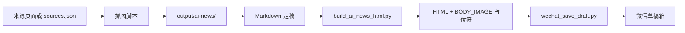

# 架构说明

## 组件职责

- `fetch_ai_news_issue.py`：针对一组固定来源抓取图片并生成封面候选。
- `fetch_ai_news_assets.py`：从来源 JSON 提取页面元数据和图片。
- `fetch_ai_news_images.py`、`fetch_ai_news_fallbacks.py`：历史或备用抓取流程，保留用于兼容旧产物。
- `build_ai_news_html.py`：只负责 Markdown 到 HTML 的轻量转换和文本转义。
- `wechat_save_draft.py`：负责凭据加载、微信接口调用、图片占位符替换以及草稿创建/更新。
- `.claude/skills/ai-news.md`：编辑流程和授权边界的文字规范，不是运行时依赖。

## 信任边界

来源 URL、Markdown/HTML、图片路径和环境变量都属于外部输入。抓图会产生网络请求，草稿脚本会产生外部上传副作用；因此运行者必须先核验输入和授权。项目不把生成物视为可公开发布资产。
